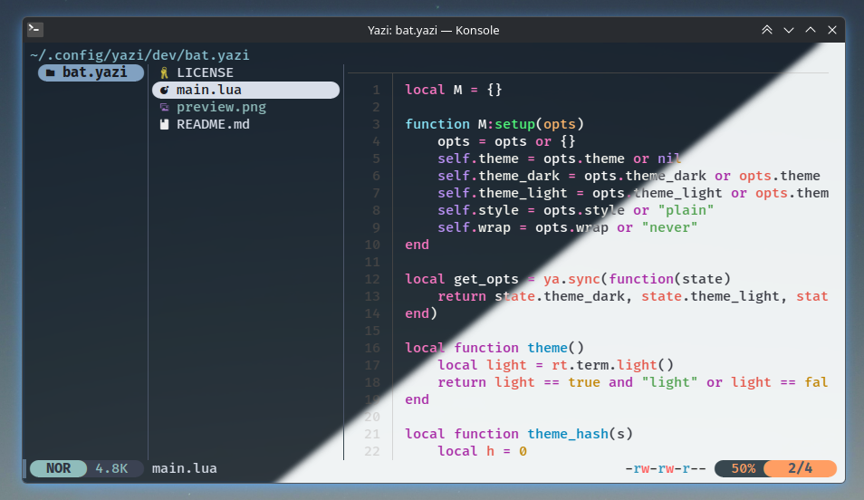

# bat.yazi

Plugin for `Yazi` to preview all supported files via `Bat`.

## Preview




## Installation


## Configuration

Edit `~/.config/yazi/yazi.toml` and add `bat` as the previewer for the file types of your choice.

```toml
[plugin]
prepend_previewers = [
  # Broad: any text-mimed file
  { mime = "text/*",              run = "bat" },
  { mime = "application/json",    run = "bat" },
  { mime = "application/x-yaml",  run = "bat" },
  { mime = "application/toml",    run = "bat" },

  # Fallback globs for extensions that mime detection may miss
  { url = "*.swift",    run = "bat" },
  { url = "*.rs",       run = "bat" },
  { url = "*.go",       run = "bat" },
  { url = "*.py",       run = "bat" },
  { url = "*.js",       run = "bat" },
  { url = "*.mjs",      run = "bat" },
  { url = "*.cjs",      run = "bat" },
  { url = "*.ts",       run = "bat" },
  { url = "*.tsx",      run = "bat" },
  { url = "*.jsx",      run = "bat" },
  { url = "*.rb",       run = "bat" },
  { url = "*.lua",      run = "bat" },
  { url = "*.sh",       run = "bat" },
  { url = "*.bash",     run = "bat" },
  { url = "*.zsh",      run = "bat" },
  { url = "*.c",        run = "bat" },
  { url = "*.cpp",      run = "bat" },
  { url = "*.cc",       run = "bat" },
  { url = "*.h",        run = "bat" },
  { url = "*.hpp",      run = "bat" },
  { url = "*.css",      run = "bat" },
  { url = "*.html",     run = "bat" },
  { url = "*.htm",      run = "bat" },
  { url = "*.md",       run = "bat" },
  { url = "*.markdown", run = "bat" },
  # ...add your own
]
```


## References

* [Yazi - A fast terminal file manager](https://yazi-rs.github.io)
* [Bat - A cat(1) clone with wings](https://github.com/sharkdp/bat)
